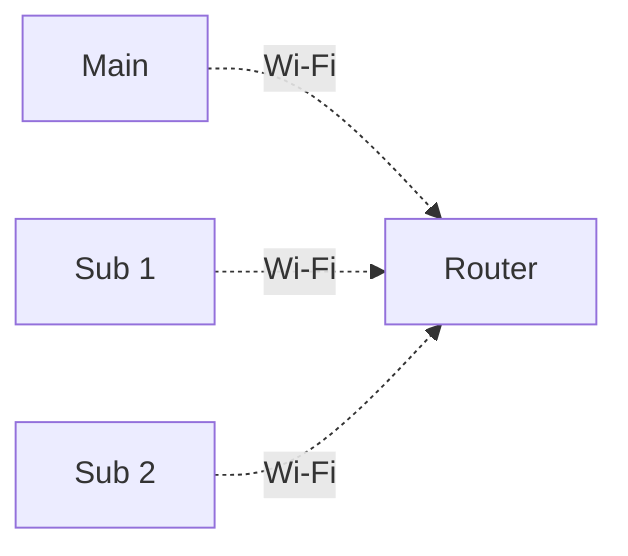
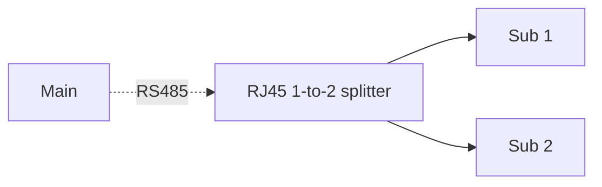

# Cluster Guide

## 1. What Is a Cluster

A cluster is a system that combines multiple micro energy storage devices into a single coordinated system, allowing them to work together for power supply, energy storage, and energy management.

In a cluster system, one device must be configured as the main unit, which is responsible for system control and coordination. The remaining devices operate as sub units connected to the same cluster. All devices communicate and work together automatically.

After clustering is enabled, both the total output power and total storage capacity of the system increase, making it suitable for higher loads, longer backup duration, or future system expansion.

---

## 2. Why Use a Cluster

A single device has limited power output and storage capacity. When higher power output or longer backup duration is required, clustering can be used to expand system capability.

**Increase Output Power**

Multiple devices can supply power simultaneously, allowing the system to support larger loads.

> Example:
> - One SolidFlex 2000 unit can provide up to approximately 2400W inverter output.
> - Two devices in a cluster can provide up to approximately 4800W inverter output.
> - Actual available output power may still be limited by grid conditions, wiring specifications, and local regulations.

**Increase Storage Capacity**

After clustering is enabled, the batteries of all devices work together, significantly extending backup time.

> Example:
> - One SolidFlex 2000 with 5 SFA1800 batteries provides a total battery capacity of 10.8kWh.
> - Two clustered systems provide approximately 21.6kWh total capacity.

**Flexible Expansion**

The system supports gradual expansion. Users can start with a single device and add more devices later according to actual needs, without completing the entire installation at once. This is ideal for phased deployment.

---

## 3. Supported Devices

The following models can be used as main or sub units:

<table>
<thead>
  <tr>
    <th></th>
    <th colspan="2">Centralized Cluster</th>
    <th colspan="2">Coordinated Cluster</th>
  </tr>
</thead>
<tbody>
  <tr>
    <td>Model</td>
    <td>Main</td>
    <td>Sub</td>
    <td>Main</td>
    <td>Sub</td>
  </tr>
  <tr>
    <td>BK1600</td>
    <td>❌</td>
    <td>✅</td>
    <td>✅</td>
    <td>✅</td>
  </tr>
  <tr>
    <td>BK1600 Ultra</td>
    <td>✅</td>
    <td>✅</td>
    <td>✅</td>
    <td>✅</td>
  </tr>
  <tr>
    <td>SolidFlex 2000 PowerFlex 2000 SolidFlex 2000 Eco PowerFlex 2000 Eco</td>
    <td>✅</td>
    <td>✅</td>
    <td>✅</td>
    <td>✅</td>
  </tr>
    <tr>
    <td>SolidFlex 1200</td>
    <td>✅</td>
    <td>✅</td>
    <td>✅</td>
    <td>✅</td>
  </tr>
  <tr>
    <td>SolidFlex 3000 AC SolidFlex 3000 AC Pro SolidFlex 3000 Hybrid Pro PowerFlex 3000 AC PowerFlex 3000 Hybrid</td>
    <td>✅</td>
    <td>✅</td>
    <td>✅</td>
    <td>✅</td>
  </tr>
</tbody>
</table>

:::info

- Mixed clusters combining SolidFlex / PowerFlex series and BK series have not been fully validated and is not recommended. However, SolidFlex and PowerFlex series models can be connected in parallel with each other.
- During cluster operation:
  - PV input through the **PV port** is supported

:::

---

## 4. Cluster Modes

The cluster supports a maximum of **3 devices**:

- 1 main device
- Up to 2 sub devices

Depending on the installation environment, the following two modes can be selected:

### 4.1 Coordinated Cluster

Each device connects independently to the grid and handles its own AC input and output. Devices synchronize data through the communication network, while the main unit coordinates system operation and power distribution.

import Tabs from '@theme/Tabs';
import TabItem from '@theme/TabItem';

<Tabs>
  <TabItem value="gen1" label="SolidFlex / PowerFlex" default>
    
  </TabItem>
  <TabItem value="gen2" label="BK1600 / BK1600 Ultra">
    
  </TabItem>
</Tabs>

### 4.2 Centralized Cluster

Sub devices are connected sequentially to the main device through AC power cables. All AC input and output are ultimately centralized through the main device, which handles the overall grid connection and power management.

Connection method:
- The main device connects to the grid through the **GRID IN/OUT** port
- The **Backup** port of the main device connects to the **GRID IN/OUT** port of the first sub device
- If multiple sub devices are used, continue cascading connections through **Backup → GRID IN/OUT**

<Tabs>
  <TabItem value="gen1" label="SolidFlex / PowerFlex" default>
    
  </TabItem>
  <TabItem value="gen2" label="BK1600 / BK1600 Ultra">
    
  </TabItem>
</Tabs>

---

## 5. Cluster Communication Methods

Devices must maintain communication to synchronize operating status. The following two communication methods are supported:

### 5.1 Wi-Fi Communication

Connect all devices to the same Wi-Fi network. This method is suitable for scenarios where devices are installed close to each other and a stable Wi-Fi network is available.

### 5.2 RS485 Communication

Use a network cable to connect the main and sub devices through the RS485 ports. This method is suitable for environments with poor network conditions or scenarios requiring stable wired communication.

To connect two sub devices, use an **RJ45 1-to-2 splitter** to connect the main device and sub devices.

**RJ45 Pinout**

| Pin | Signal  | Function                                            |
| --- | ------- | --------------------------------------------------- |
| 1   | GND     | Shield ground                                       |
| 2   | GND     | Shield ground                                       |
| 3   | N.C.    | Not connected                                       |
| 4   | RS485 A | RS485 differential signal A (for Indevolt Smart CT) |
| 5   | RS485 B | RS485 differential signal B (for Indevolt Smart CT) |
| 6   | N.C.    | Not connected                                       |
| 7   | DC 5V   | 5 V power supply, maximum current: 200 mA           |
| 8   | DC 5V   | 5 V power supply, maximum current: 200 mA           |

:::info
If the device currently only supports Wi-Fi and RS485 parallel connection is required, the communication module can be replaced with a newer version. For details, see: [Accessory Replacement](../advanced/accessory-replacement.md)
:::

---

## 6. Cluster Power Limitations

After devices are configured as a cluster, the maximum system power depends on:

* Cluster mode
* Device model

Where:

* **AC input power** determines the maximum power that the system can obtain from the grid.
* **AC output power** determines the maximum power that the system can provide to loads.

:::danger
Ensure that the maximum system output power complies with local electrical standards and safety regulations.
:::

### 6.1 Single Device Power

The maximum AC input/output capability of each device model is as follows:

| Model       | Maximum AC Output/Input Power |
| ----------- | ----------------------------- |
| BK Series   | 1200 W                        |
| 2000 Series | 2400 W                        |
| 1200 Series | 1200 W                        |
| 3000 Series | 3000 W                        |

### 6.2 Maximum AC Input Power

After parallel connection, multiple devices can support AC input simultaneously.

Maximum cluster AC input power = Sum of the maximum AC input power of all cluster devices

### 6.3 Maximum AC Output Power

The maximum AC output power after parallel connection depends on the cluster mode.

* **Coordinated cluster:**
  Maximum cluster AC output power = Sum of the maximum AC output power of all cluster devices

* **Centralized cluster:**
  The AC input and output of all devices are ultimately connected to the grid through the main device. Therefore, the AC output capability is limited by the power capacity of the main device.

  | Main Model | Maximum Cluster AC Output Power |
  | ------------ | ------------------------------- |
  | BK1600 Ultra | 2300 W                          |
  | 2000 Series  | 3600 W                          |
  | 1200 Series  | 2300 W                          |
  | 3000 Series  | 3600 W                          |

:::note
When devices are configured as a cluster, connecting microinverters and loads through the bypass port may cause inaccurate power display. This function is still being optimized.
:::

---

## 7. Cluster Power Distribution

During cluster operation, the system automatically distributes power based on device SOC and load conditions. Therefore:
- Different devices may output different power levels
- Not all devices will participate in output at the same time
- Devices with higher SOC may prioritize supplying the load

Typical system behavior under different load conditions:

| Load Power    | System Behavior |
| ------------- | ---------------- |
| Below 200W    | Only the device with the highest SOC supplies power |
| 200W ~ 500W   | Two devices with higher SOC share the load |
| Above 500W    | All sub devices participate and distribute power based on SOC ratio |

---

## 8. How to Create a Cluster

A cluster can be configured through the INDEVOLT App.

Before starting, make sure:
- All devices support clustering
- All devices are powered on
- All devices are connected to the network properly and have been added to the same home.
- For RS485 cluster operation, the communication cables are connected correctly.

### Step 1: Enter Cluster Settings

On the device details page, tap the  icon in the upper-right corner to enter the settings page, then select **Cluster**.

Tap **Create a Cluster** to create a new cluster.

### Step 2: Select Cluster Mode

Select the cluster mode: **Centralized** or **Coordinated**.

### Step 3: Add Main and Sub Devices

In the list of compatible devices, press and hold a device card, then drag the device to the Main or Sub area.

### Step 4: Select Communication Method

Select the communication method between cluster devices: **Wi-Fi** or **RS485**.

If **RS485** communication is selected:
- The device must be installed with a LAN module that supports RS485 communication.
- Use a standard network cable to connect to the device's RS485 port.

### Step 5: Configure Cluster Parameters

Configure the basic cluster settings, including the cluster name and power-related limits, then tap **Save** to complete the creation.

:::danger
Ensure all configuration parameters comply with local grid requirements and regulations.
:::

### Step 6: View and Manage the Cluster

After successful configuration, the App automatically enters the cluster details page, where you can view the overall system status, including main/sub relationships, real-time power, and energy strategies.

Tap the  icon in the upper-right corner to enter settings, where you can further manage the cluster, such as modifying parameters or removing the cluster relationship.

