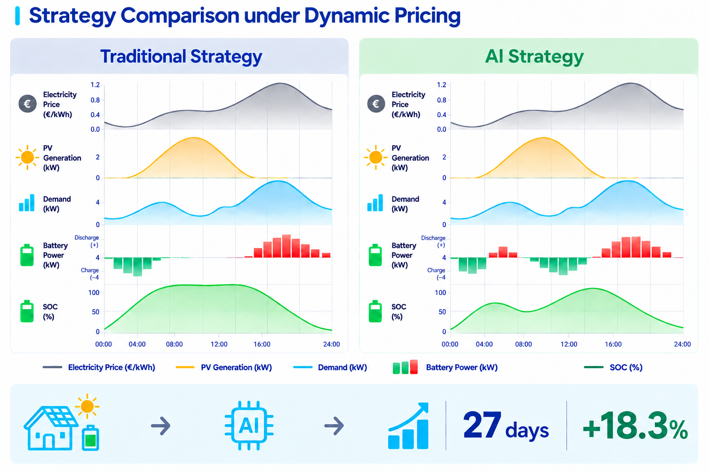
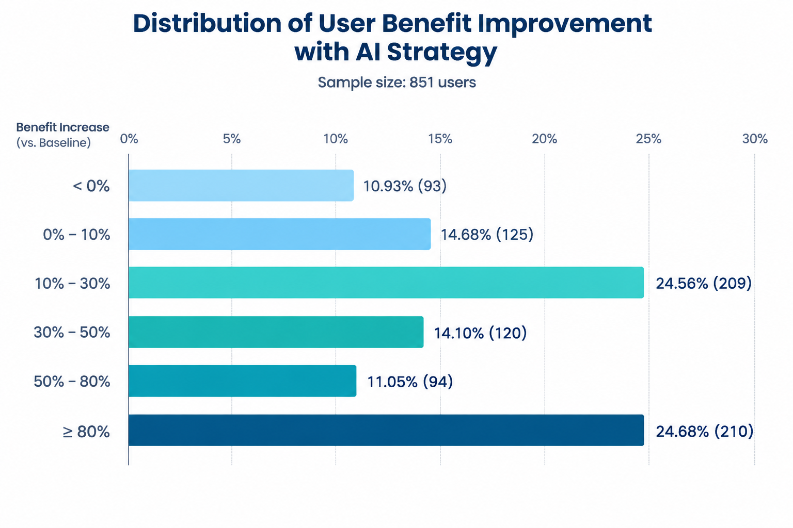

# Stratégie AI

## Stratégie intelligente de gestion de l’énergie pour le stockage résidentiel

## 1. Pourquoi une stratégie AI est-elle nécessaire ?

De nombreux foyers installent des systèmes photovoltaïques et de stockage d’énergie afin de réduire leurs dépenses d’électricité et de mieux utiliser l’énergie solaire. Pour atteindre cet objectif, outre les performances de l’appareil, la planification quotidienne des cycles de charge et de décharge est également essentielle.

Si les périodes de charge et de décharge ne sont pas adaptées aux variations des prix de l’électricité, des conditions météorologiques et de la consommation du foyer, la batterie peut ne pas se charger ou se décharger au moment le plus approprié. Les problèmes les plus courants sont les suivants.

### Problème 1 : un moment de décharge inadapté entraîne un achat d’électricité pendant les périodes de prix élevés

Avant de quitter le domicile le matin et après le retour au domicile le soir, la consommation électrique du foyer est souvent particulièrement élevée. Des appareils tels qu’un cuiseur à riz, un climatiseur ou un chauffe-eau peuvent fonctionner simultanément, ce qui entraîne une forte charge du foyer. Ces périodes peuvent également correspondre à des prix de l’électricité plus élevés.

Une stratégie fixe déclenche la décharge selon des plages horaires prédéfinies et ne peut pas identifier précisément les pics de charge du foyer et les pics de prix de l’électricité. La batterie peut ainsi être déjà déchargée avant la fin de la période de pointe, ce qui oblige ensuite à acheter de l’électricité sur le réseau à un prix élevé.

### Problème 2 : une planification de la charge inadaptée empêche une utilisation efficace de l’énergie photovoltaïque excédentaire

Lors d’un week-end ensoleillé, la production photovoltaïque peut être nettement supérieure à la consommation électrique instantanée du foyer. Si la batterie a déjà été entièrement chargée selon un programme fixe au petit matin, l’énergie photovoltaïque excédentaire produite à midi ne peut pas être stockée et peut être injectée sur le réseau à un prix plus faible.

Pendant les périodes de prix élevés le soir, la batterie peut alors ne plus disposer d’une quantité d’énergie suffisante. Cette situation peut se reproduire pour les foyers disposant d’une installation photovoltaïque importante et bénéficiant de nombreuses journées ensoleillées.

### Problème 3 : les règles fixes ne peuvent pas s’adapter aux changements continus

Les tarifs d’électricité selon les plages horaires peuvent varier entre les jours ouvrés, les week-ends et les périodes de pointe. Les conditions météorologiques et les habitudes de consommation du foyer évoluent également en permanence, ce qui influence la production photovoltaïque et la charge du foyer.

Une stratégie fixe configurée une seule fois et utilisée sur une longue période peut facilement ne plus correspondre aux conditions réelles. Les ajustements manuels fréquents sont non seulement chronophages, mais ne permettent pas non plus d’obtenir durablement de meilleurs résultats.

### Problème 4 : se concentrer uniquement sur les coûts d’électricité à court terme au détriment de la durée de vie de la batterie

La batterie de stockage est un élément important du système. Des cycles de charge et de décharge profonds sur une longue période, ou des variations fréquentes et importantes de la puissance de charge et de décharge, peuvent accélérer le vieillissement de la batterie.

Si l’objectif est uniquement de réduire les coûts d’électricité à court terme sans tenir compte de la gestion de la durée de vie de la batterie, une utilisation excessive de la batterie peut augmenter les coûts de remplacement futurs et réduire la rentabilité globale du système.

Le point commun de ces problèmes est le suivant : une stratégie fixe fonctionne selon des horaires prédéfinis et ne peut pas anticiper les variations du lendemain concernant les prix de l’électricité, les conditions météorologiques et la consommation du foyer. Le programme de charge et de décharge du système de stockage d’énergie doit donc être ajusté dynamiquement chaque jour en fonction des conditions réelles.

## 2. Qu’est-ce qu’une stratégie AI ?

Une stratégie AI permet au système de stockage d’énergie de déterminer automatiquement chaque jour quand charger et quand décharger la batterie en fonction des prix de l’électricité, des conditions météorologiques et de la consommation du foyer.

Le système anticipe les prix de l’électricité, la production photovoltaïque et la consommation du foyer sur une période à venir, puis planifie les cycles de charge et de décharge pour les différentes périodes de la journée.

Chaque jour, le système prend principalement en compte les quatre types d’informations suivants afin de générer le programme de charge et de décharge :

| Informations de référence | Fonction |
| --- | --- |
| Prix de l’électricité | Identifie les périodes où les prix de l’électricité sont plus bas ou plus élevés. |
| Production photovoltaïque | Détermine la production photovoltaïque et les périodes où un surplus d’énergie photovoltaïque peut être disponible. |
| Charge du foyer | Identifie les périodes de forte consommation ainsi que les différences entre les jours ouvrés et les week-ends. |
| État de la batterie | Détermine le niveau d’énergie actuel de la batterie, la capacité disponible pour la charge et la décharge, ainsi que l’énergie à conserver en réserve. |

Le système combine les prix de l’électricité, les conditions météorologiques et la consommation du foyer afin de planifier les périodes de charge et de décharge les plus appropriées. Si les conditions réelles changent, le programme est ajusté en conséquence.

Prenons un scénario typique :

Dans un scénario d’utilisation d’un système de stockage d’énergie, les performances d’une stratégie fixe traditionnelle et celles d’une stratégie d’optimisation dynamique AI sont comparées dans les mêmes conditions de prix dynamiques de l’électricité, de production photovoltaïque et de charge du foyer.

Comme indiqué sur la figure, la stratégie traditionnelle charge et décharge à des heures prédéfinies (fonctionnement à horaires fixes), tandis que la stratégie AI sélectionne dynamiquement les périodes de charge et de décharge en fonction des prix de l’électricité, de la production photovoltaïque et de la charge (optimisation dynamique). Les données de fonctionnement réelles montrent que, par rapport à la stratégie traditionnelle, la stratégie AI a généré des bénéfices supérieurs de 18,3 %, avec un bénéfice supplémentaire de 6 048,83 CNY dans ce cas particulier.

**Figure 1 : Comparaison de la planification de la stratégie traditionnelle et de la stratégie AI dans un scénario de tarification dynamique**

## 3. Principales fonctions de la stratégie AI d’Indevolt

La stratégie AI d’Indevolt répond à plusieurs problèmes clés rencontrés par les utilisateurs de systèmes de stockage résidentiel. En planifiant dynamiquement les cycles de charge et de décharge, elle permet au système de stockage d’énergie de mieux s’adapter aux variations quotidiennes des prix de l’électricité, des conditions météorologiques et de la consommation du foyer.

### 1. Réduire les coûts d’électricité : planifier intelligemment les périodes de charge et de décharge

Les avantages du stockage résidentiel dépendent non seulement de la capacité de la batterie, mais également des périodes auxquelles la batterie est chargée et déchargée.

En ajustant les périodes de charge et de décharge, le système peut réduire les achats inutiles d’électricité sur le réseau pendant les périodes de prix élevés et utiliser autant que possible l’électricité à bas prix et l’énergie photovoltaïque. Les résultats réels peuvent varier en fonction des prix locaux de l’électricité, de la configuration photovoltaïque, des conditions de l’appareil et des habitudes de consommation du foyer.

Cela se traduit principalement par trois aspects :

- **Meilleure utilisation de la batterie :** en fonction des prix de l’électricité et de la consommation du foyer, la batterie est rechargée aux moments appropriés et l’énergie stockée est utilisée pendant les périodes où elle est davantage nécessaire, ce qui réduit les périodes d’inactivité prolongées de la batterie.
- **Taux d’autoconsommation photovoltaïque plus élevé :** lorsqu’une production photovoltaïque plus importante est prévue à midi, le système réserve à l’avance une capacité suffisante dans la batterie afin de stocker autant que possible l’énergie photovoltaïque excédentaire produite par la suite et d’améliorer l’utilisation locale de l’énergie photovoltaïque.
- **Décharge plus précise et réduction des achats sur le réseau :** en tenant compte des prix de l’électricité et de la charge du foyer à différents moments, le système privilégie l’utilisation de l’énergie disponible dans la batterie pendant les périodes où elle est la plus nécessaire, réduisant ainsi les achats d’électricité sur le réseau pendant les périodes de prix élevés.

Sur la base des données de fonctionnement réelles de 851 utilisateurs, la stratégie AI d’Indevolt a démontré des avantages significatifs en matière de réduction des coûts :

**Figure 2 : Répartition de l’amélioration des revenus des utilisateurs de la stratégie AI (données issues des statistiques de fonctionnement réelles de 851 utilisateurs)**

Les données montrent que la stratégie AI d’Indevolt peut permettre à la grande majorité des utilisateurs de réaliser des économies concrètes sur leurs factures d’électricité. L’amélioration médiane des revenus se situe entre 10 % et 30 %, tandis que près d’un quart des utilisateurs (24,68 %) ont enregistré une amélioration supérieure à 80 %. Dans l’ensemble, la plupart des utilisateurs peuvent réaliser des économies d’électricité à des degrés différents. Le montant réel des économies dépend des prix locaux de l’électricité, de la configuration photovoltaïque, des habitudes de consommation du foyer et des conditions de l’appareil.

### 2. Fonctionnement automatique : réduire les réglages quotidiens

Les prix de l’électricité, les conditions météorologiques et les habitudes de consommation du foyer peuvent varier chaque jour. Si les utilisateurs ajustent manuellement les périodes de charge et de décharge, cela nécessite des interventions fréquentes et ne permet pas nécessairement de suivre rapidement les conditions réelles.

Après l’activation de la stratégie AI, le système effectue automatiquement ces ajustements. Il n’est donc pas nécessaire de reconfigurer le système chaque jour :

- **Génération automatique du programme :** génère un programme de charge et de décharge en fonction des prix de l’électricité, des conditions météorologiques et des habitudes de consommation du foyer.
- **Ajustement automatique du programme :** ajuste les opérations suivantes en fonction des changements de météo, de production photovoltaïque ou de consommation du foyer.
- **Fonctionnement continu :** une fois la stratégie configurée, aucune intervention quotidienne fréquente n’est nécessaire ; le système de stockage d’énergie fonctionne automatiquement selon le programme.

### 3. Fonctionnement transparent : comprendre la raison de chaque opération

Un système de stockage d’énergie peut effectuer plusieurs opérations de charge, de décharge ou rester en veille au cours d’une journée. Pour les utilisateurs, il est important de savoir non seulement « comment le système fonctionne », mais également « pourquoi il fonctionne ainsi ».

Si l’utilisateur souhaite savoir pourquoi le système charge, décharge ou reste en veille à un moment donné, il peut consulter directement la raison correspondante, par exemple :

- **Pourquoi le système charge-t-il maintenant ?** Le prix actuel de l’électricité est bas et le moment est adapté pour recharger la batterie.
- **Pourquoi le système décharge-t-il maintenant ?** La demande électrique actuelle est élevée ou le prix de l’électricité est relativement élevé.
- **Pourquoi le système ne charge-t-il et ne décharge-t-il pas temporairement ?** Les conditions actuelles de prix de l’électricité, de production photovoltaïque ou de charge du foyer ne sont temporairement pas adaptées à un cycle de charge ou de décharge.

Des raisons de fonctionnement claires et accessibles permettent aux utilisateurs de mieux comprendre les décisions du système et de consulter plus facilement son fonctionnement réel.

### 4. Prendre en compte la durée de vie de la batterie : réduire les coûts à long terme

Outre les coûts d’électricité quotidiens, la planification des cycles de charge et de décharge influence également l’utilisation à long terme de la batterie.

Lors de l’élaboration du programme de charge et de décharge, le système prend en compte l’état actuel de la batterie et l’énergie disponible afin d’éviter les opérations de charge et de décharge inutiles et d’établir un équilibre entre les coûts d’électricité et l’utilisation à long terme de la batterie.

Une planification plus appropriée des cycles de charge et de décharge peut réduire les cycles profonds inutiles et les variations fréquentes, contribuant ainsi à réduire l’usure supplémentaire de la batterie pendant son fonctionnement à long terme.

La stratégie ne tient pas seulement compte des économies réalisées aujourd’hui, mais aussi de la manière dont la batterie doit être utilisée sur le long terme.

## 4. Questions fréquemment posées

### Q1 : Pourquoi la stratégie AI achète-t-elle parfois de l’électricité sur le réseau alors que la batterie contient encore de l’énergie ?

Cela ne signifie pas nécessairement que la stratégie fonctionne anormalement. La stratégie AI prend en compte le coût global sur l’ensemble de la journée, voire sur une période plus longue, plutôt que de considérer uniquement l’achat d’électricité au moment présent. Le système peut conserver de l’énergie pour une période ultérieure où le prix de l’électricité sera plus élevé ou attendre une occasion de recharge à un coût plus faible.

### Q2 : Pourquoi le mode AI ne charge-t-il pas la batterie à 100 % et pourquoi peut-il injecter de l’électricité sur le réseau alors que la batterie n’est pas pleine ?

Le niveau de charge cible de la batterie est ajusté dynamiquement et ne signifie pas que la batterie doit toujours être complètement chargée. Le système prend notamment en compte la demande énergétique future, les prévisions photovoltaïques, les prix d’achat et de vente de l’électricité, les pertes de charge et de décharge ainsi que les limites de puissance. Si le revenu attendu de l’injection sur le réseau est supérieur au bénéfice attendu d’un stockage supplémentaire, l’injection peut également être appropriée lorsque la batterie n’est pas pleine.

### Q3 : Est-il normal que la puissance de charge/décharge soit très faible ou que le programme semble inadapté le premier jour après l’activation du mode AI ?

C’est normal. Lors de la première activation, le système dispose de peu d’informations sur les habitudes de consommation du foyer. Lorsque les données historiques sont insuffisantes, il fonctionne de manière plus prudente, réduit la puissance et limite le nombre d’opérations. À mesure que les données valides concernant la charge, la production photovoltaïque et les prix de l’électricité s’accumulent, la stratégie s’ajuste et s’optimise progressivement.

### Q4 : Pourquoi les prévisions photovoltaïques de l’AI restent-elles à 0 alors qu’un onduleur photovoltaïque est connecté et que la production en temps réel est visible ?

Pour prévoir la production photovoltaïque, le système prend en compte à la fois la puissance de production en temps réel signalée par l’appareil et la puissance photovoltaïque installée configurée dans les paramètres de la stratégie. Si ce paramètre est défini sur 0, la prévision peut également être affichée à 0.

### Q5 : Pourquoi l’AI ne charge-t-elle pas la batterie pendant chaque période de prix bas ? Dois-je définir manuellement l’écart entre les prix d’achat et de vente ?

Non. Un prix bas de l’électricité ne signifie pas nécessairement que la charge est rentable, car des pertes d’énergie se produisent lors de la charge et de la décharge. La charge et la décharge ne sont pertinentes que lorsque l’écart de prix est suffisant pour couvrir ces pertes. Le système effectue automatiquement cette évaluation.

### Q6 : La batterie ne s’est pas complètement déchargée pendant la nuit. Cela signifie-t-il que la stratégie AI ne fonctionne pas correctement ?

Pas nécessairement. La puissance maximale de décharge limite la puissance pouvant être fournie pendant une période donnée. Par exemple, si la puissance maximale de décharge est de 800 W, la batterie ne dépassera pas cette limite même si la charge du foyer est supérieure. Si la durée de la nuit n’est pas suffisamment longue ou si le foyer ne consomme pas suffisamment d’électricité, il est possible que la batterie conserve un niveau de charge relativement élevé le matin.

### Q7 : Je souhaite que la batterie se charge et se décharge chaque jour à des heures et à des puissances fixes et atteigne un niveau d’énergie défini. Dois-je utiliser le mode AI ?

Si vous souhaitez que le système charge et décharge strictement à des heures et à des puissances fixes et atteigne un niveau d’énergie défini, un programme de charge/décharge personnalisé ou automatique est généralement plus adapté.

Le mode AI planifie dynamiquement le fonctionnement sur la base de données prévisionnelles. Il ne garantit donc pas que le système fonctionnera à la même heure chaque jour ni que la batterie sera toujours chargée à 100 %.

### Q8 : Pourquoi la batterie reste-t-elle en veille lorsque l’AI indique « aucun avantage clair lié à l’écart de prix entre achat et vente d’électricité » ?

Lorsque l’écart de prix prévu est insuffisant pour couvrir les pertes de charge et de décharge, ou lorsqu’il n’existe temporairement aucune possibilité plus appropriée de charger ou de décharger, le mode veille permet d’éviter les opérations inutiles. Le mode veille ne signifie pas que le système est hors ligne.

### Q9 : Combien de temps faut-il pour voir les résultats ?

Le système a besoin d’un certain temps pour comprendre les habitudes de consommation du foyer, généralement 1 à 2 semaines. À mesure que les données s’accumulent, les prévisions deviennent progressivement plus précises. En général, les résultats deviennent plus stables après 2 à 4 semaines d’utilisation.

### Q10 : Que se passe-t-il par temps nuageux ou lorsque la production photovoltaïque est insuffisante ?

Le système ajuste le programme en fonction des prévisions météorologiques. Si une faible production photovoltaïque est prévue pour le lendemain, le système peut recharger la batterie à l’avance pendant les périodes où le prix de l’électricité est plus bas afin de répondre à la demande énergétique ultérieure.

### Q11 : Que se passe-t-il si des invités arrivent soudainement et que la consommation électrique du foyer augmente ?

Le système surveille en continu les variations de la consommation du foyer. Lorsque la consommation augmente soudainement, il réajuste le programme de charge et de décharge, donne la priorité à l’alimentation normale du foyer et cherche à réduire les achats d’électricité sur le réseau pendant les périodes de prix élevés.

### Q12 : Pourquoi l’AI ne charge-t-elle pas nécessairement à pleine puissance pendant les périodes de prix bas ?

Une période de prix bas ne signifie pas que la batterie doit être chargée en continu à pleine puissance, c’est-à-dire à la puissance de charge maximale actuellement autorisée par l’appareil. La stratégie AI planifie dynamiquement les périodes et les quantités de charge en fonction de la consommation réelle du foyer et de la demande énergétique future. Le système prend également en compte l’utilisation à long terme de la batterie et planifie la charge aux moments appropriés afin d’éviter une charge prolongée, concentrée et à forte puissance, tout en équilibrant les besoins énergétiques et la durée de vie de la batterie.

Ainsi, même pendant une période de prix bas, la stratégie AI peut réduire la puissance de charge ou suspendre temporairement la charge en fonction des conditions réelles. Il s’agit d’un fonctionnement normal résultant de l’évaluation globale effectuée par la stratégie.

## 5. Résumé

L’installation d’un système photovoltaïque et d’un système de stockage d’énergie dans un foyer vise principalement à réduire les coûts d’électricité et à mieux utiliser l’énergie solaire. Cependant, si les périodes de charge et de décharge ne sont pas correctement planifiées, les bénéfices globaux peuvent être affectés : si la batterie ne se charge pas au moment où cela est nécessaire ou ne se décharge pas au moment approprié, les économies réalisées sur une année peuvent être limitées.

La stratégie AI d’Indevolt vise à résoudre ce problème : elle prend chaque jour en compte les prix de l’électricité, les conditions météorologiques et la consommation du foyer afin de générer et d’ajuster automatiquement le programme de charge et de décharge, réduisant ainsi les réglages manuels.

Les principales fonctionnalités sont les suivantes :

| Fonction principale | Ce que l’utilisateur peut constater |
| --- | --- |
| Réduire les coûts d’électricité | Dans des conditions appropriées, réduire les achats inutiles d’électricité sur le réseau. |
| Fonctionnement automatique | Générer automatiquement un programme et l’ajuster lorsque les conditions changent. |
| Fonctionnement transparent | Afficher les raisons des opérations planifiées pour chaque période. |
| Gestion de la durée de vie de la batterie | Réduire l’usure inutile de la batterie tout en réalisant des économies d’électricité. |

La stratégie AI ne fonctionne pas selon une seule règle fixe. Elle prend en compte simultanément les prix de l’électricité, les conditions météorologiques, la consommation du foyer et l’état de la batterie afin de mettre en place une planification plus appropriée, conciliant les économies d’électricité et l’utilisation à long terme de la batterie.

Ce document est basé sur les fonctionnalités actuelles de la stratégie AI d’Indevolt. Les bénéfices réels varient notamment en fonction des prix locaux de l’électricité, de la puissance photovoltaïque installée, des habitudes de consommation du foyer et de la configuration de l’appareil.
